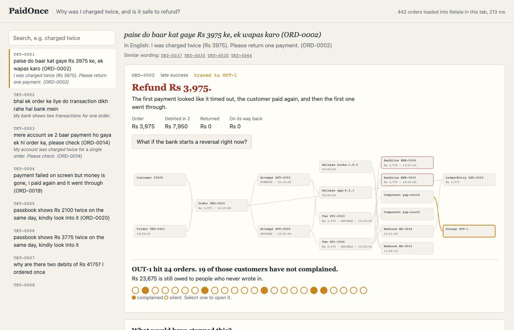
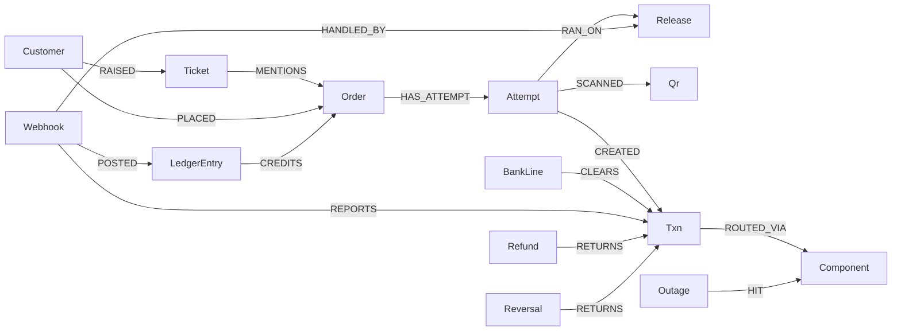

# PaidOnce

**A customer says "I was charged twice". PaidOnce shows why, says whether a refund is safe right now, and finds everyone else hit by the same cause who has not complained yet.**

**[Live demo](https://utsxvrai.github.io/paidonce/)** (runs in your browser, nothing to install)

> All data in this repository is synthetic. No real customer, bank, or payment appears in it.



## Use case

Support teams answer "I was charged twice" by reading the ledger, the gateway, the bank statement and the release log side by side. The obvious rule (same customer, same amount, minutes apart: refund one) goes wrong in four ways:

- There was one debit, and our own ledger recorded it twice.
- The customer placed two orders.
- The bank is already reversing one payment, so a refund pays it back twice.
- One payment is still undecided, so nobody knows yet.

And each ticket is usually one visible case of a bigger problem: an outage, a bad release, a reusable QR code.

The relationships that matter are the ones between systems that do not know about each other: a retry and the timeout before it, a webhook and the release that handled it, a gateway and its outage, a debit and the reversal coming back.

## How it uses Relate

- **Mode:** single file, `store/paidonce.rl`.
- **Why this mode:** one month of payment history is something you want to hand over whole. The CLI and the agent server open the same file **read-only**, so nothing that asks a question can change the evidence. What-if runs, which must write, use an in-memory graph. The browser demo uses Relate's WebAssembly build, also in memory.
- **What the graph models:**



| Relate feature | Where |
|---|---|
| Embedded Node library, single-file store, read-only open | [`src/native.ts`](src/native.ts), [`src/open.ts`](src/open.ts) |
| WebAssembly build running the **same `.cypher` files** | [`web/`](web/); a test checks both engines agree on every order |
| Vector index and full-text index, each followed by traversal in one statement | [`cypher/search_similar.cypher`](cypher/search_similar.cypher), [`cypher/search_text.cypher`](cypher/search_text.cypher) |
| Correlated `CALL` subqueries, `EXISTS`, temporal arithmetic | [`cypher/money.cypher`](cypher/money.cypher), [`cypher/causes/`](cypher/causes/) |
| Explicit transactions, always rolled back | what-if in [`src/engine.ts`](src/engine.ts) |
| Uniqueness constraints | [`cypher/schema.cypher`](cypher/schema.cypher) |
| Agent access over MCP (7 tools) | [`src/mcp.ts`](src/mcp.ts), [`.mcp.json`](.mcp.json) |

**Search proposes, the graph decides.** Similar wording only suggests which tickets to open. Every cause and every refund decision comes from Cypher over payment evidence. No LLM is involved, and no API key is needed.

## Setup and run

You need Node 20 or newer, on macOS or Linux. Nothing else.

```bash
npm ci
npm run paidonce scan                          # every cause and root in the month
npm run paidonce explain TKT-0001              # why, and what is safe to do
npm run paidonce trail ORD-0002                # the evidence path
npm run paidonce blast OUT-1                   # everyone hit, and who is silent
npm run paidonce whatif idempotency-per-order  # what a fix prevents, and what it costs
npm run paidonce search do baar                # find tickets by words, Hinglish included
npm run demo                                   # browser demo on http://127.0.0.1:8787
npm test
npm run eval
```

In the demo, open a ticket that says *Refund*, press **What if the bank starts a reversal right now?** and watch the answer change. That button writes one `Reversal` node and re-runs the same queries.

**With an agent:** open this folder in an MCP client that reads `.mcp.json`, and ask: *"TKT-0001 says they were charged twice. Is it safe to refund, and who else is affected?"*

## Where the data lives

| Path | What it is |
|---|---|
| `store/paidonce.rl` | the Relate store: 3,673 nodes, 5,420 relationships |
| `data/dataset.json` | the plain rows it is built from |
| `data/vectors.json` | ticket embeddings, computed once at build time |
| `data/truth.json` | the planted answer for each order. **Never loaded into the graph** |

Rebuild the store with `npm run build:store`. Regenerate the rows with `npm run generate`, then `npm run embed` (downloads an embedding model once).

## Does it work?

`npm run eval` on 442 synthetic orders:

| Method | Wrong refunds | Wrongly paid | Missed refunds |
|---|---|---|---|
| Same customer and amount within 30 minutes | 64 | Rs 1,69,925 | 0 |
| Same rule, skipping orders with a refund or reversal | 28 | Rs 73,050 | 0 |
| PaidOnce | 0 | Rs 0 | 0 |

On 96 tickets, copying the action of the most similar ticket is right 45 times. PaidOnce is right 96 times.

**Read these numbers with care.** We wrote both the data and the rules, so a perfect score shows that the rules implement what we meant. It does not show accuracy on real payments. To keep it from being empty:

- The generator plants **near misses** that each break exactly one clause of one rule: a timeout screen on a payment that had already completed, an outage gateway on a healthy day, two correct webhook events for one payment.
- The first version of our tests passed even with rule clauses deleted. After the near misses were added, we deleted nine clauses one at a time, and the tests failed every time (`npm run test:mutation`).
- The tests run on six different seeds.
- Of the careful rule's 28 wrong refunds, 14 are orders where our policy is to hold for a person, and the other 14 are customers who placed two orders. If your policy is to refund the unexplained ones, its gap is smaller.

## Limits

- What-if replays recorded events. It does not model how customers would behave differently.
- `idempotency-per-order` also blocks 24 good payments here, and leaves 8 undecided ones waiting. The tool prints the first number on purpose.
- Vector search is weak on romanised Hindi. In a 14-sentence check, `multilingual-e5-small` ranked same-topic pairs above different-topic pairs 76% of the time (`npm run embedding-check`). That is why it never decides anything.
- Full refunds only. Partial refunds, chargebacks and settlement are not modelled.

## Disclosure

- **Started:** 24 November 2026, inside the contest period. No earlier code is reused.
- **AI tools:** built with Claude Code, which wrote most of the code, tests and documentation under the author's direction and review.
- **Third-party:** Relate 1.2.0 (Apache-2.0), the MCP TypeScript SDK, Zod, tsx, esbuild, Vitest, TypeScript, Transformers.js with `Xenova/multilingual-e5-small` (build time only). See each package for its licence.
- Not affiliated with or endorsed by Neo4j.

MIT licensed.
